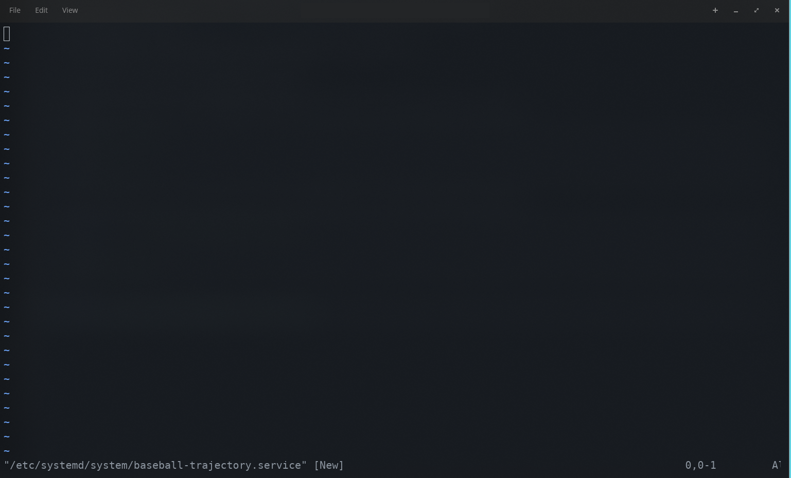
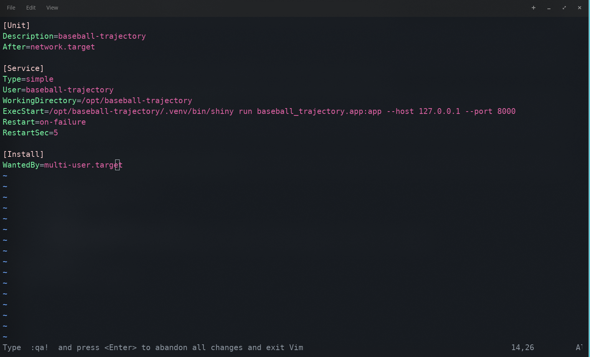
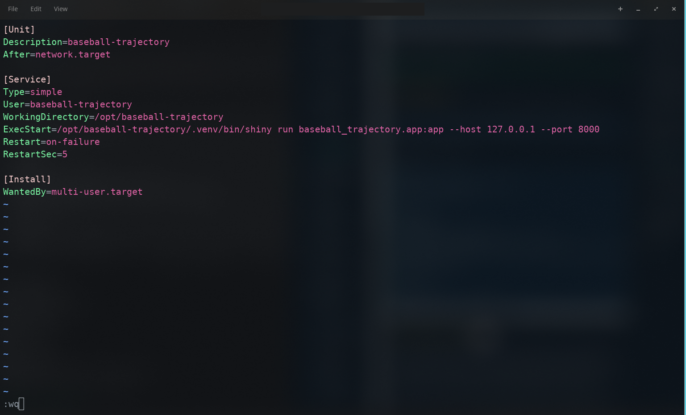
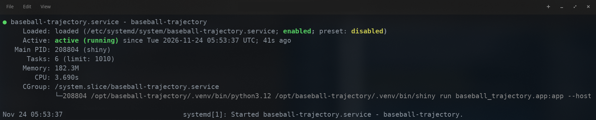
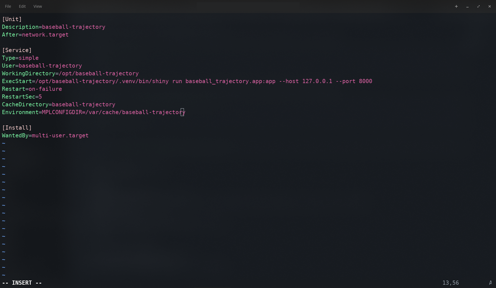
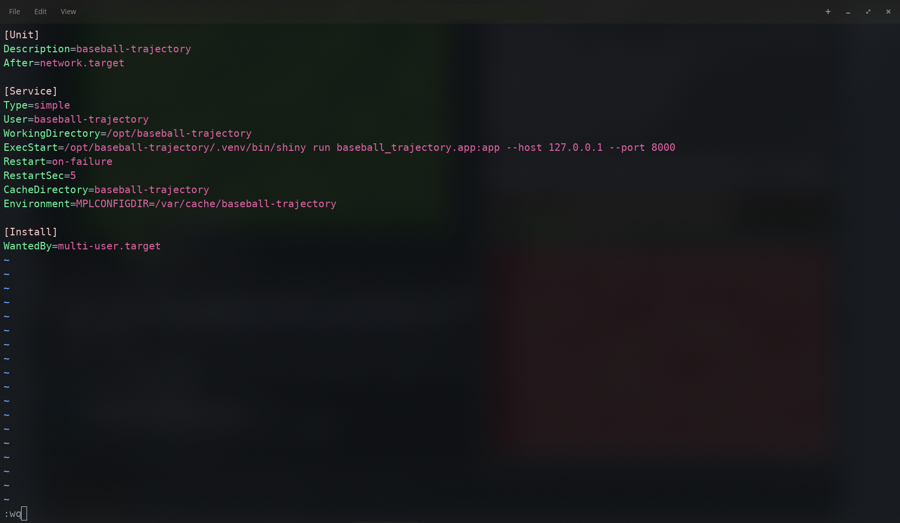

# <em>Installing a Real Application</em> {.unnumbered}

```{r}
#| label: common
#| include: false
source("_common.R")
```

```{r}
#| label: co_box_rev
#| echo: false
#| results: asis
#| eval: true
co_box(
  color = "o",
  look = "default",
  hsize = "1.25",
  size = "1.00",
  header = "Caution",
  fold = FALSE,
  contents = "This section is being revised. Thank you for your patience."
)
```

## Logging into the instance

The install runs on the same AL2023 instance we set up in [App Dependencies](app-depends.qmd), which already has Python 3.12.1 in `/opt`. Every command in this section runs on our local machine.

### Start the instance

If the instance was stopped, start it:

```{bash}
#| eval: false
#| code-fold: false
aws ec2 start-instances \
  --instance-ids i-0514a57a209efcf56 \
  --profile dev-deploy
```

`aws ec2 wait instance-running` returns once the instance is up, so the next command doesn't race it:

```{bash}
#| eval: false
#| code-fold: false
aws ec2 wait instance-running \
  --instance-ids i-0514a57a209efcf56 \
  --profile dev-deploy
```

### Look up the public IP

A stopped instance gets a new public IP address every time it starts, so look it up again:

```{bash}
#| eval: false
#| code-fold: false
aws ec2 describe-instances \
  --instance-ids i-0514a57a209efcf56 \
  --query "Reservations[*].Instances[*].PublicIpAddress" \
  --output text \
  --profile dev-deploy
```

::: {style="font-style: italic;"}

```{verbatim}
YOUR_PUBLIC_IP_ADDRESS
```

:::

### Connect

Connect as `ec2-user` with the `aws-dev` key:

```{bash}
#| eval: false
#| code-fold: false
ssh -i ~/.ssh/aws-dev.pem -o IdentitiesOnly=yes -o IdentityAgent=none ec2-user@YOUR_PUBLIC_IP_ADDRESS
```

The two `-o` options stop `ssh-agent` from offering other keys first, which can end in `Too many authentication failures`. With an entry in `~/.ssh/config` (see [SSH config](ssh-config.qmd)), the same connection is `ssh aws-dev`; update its `HostName` line with the new IP first.

The Amazon Linux 2023 banner and a `[ec2-user@ip-...]$` prompt mean we're on the instance. Two things can go wrong:

* `Connection timed out`: our home IP changed, so the port 22 rule in `dev-sg` no longer matches. The fix is in [Logging into the instance](app-depends.qmd#logging-into-the-instance).

* A fingerprint prompt: `known_hosts` stores host keys by address, and the address is new. Type `yes` (see [Host key verification](aws-ssh-ec2.qmd#host-key-verification)).

* `REMOTE HOST IDENTIFICATION HAS CHANGED`: AWS gave us an address that `known_hosts` already has for a different server. Remove the old entry with `ssh-keygen -R YOUR_PUBLIC_IP_ADDRESS` and connect again.

## Installing into `/opt`

Third party software follows the same convention as the Python and R interpreters in [App Dependencies](app-depends.qmd). These are typically installed in their own directory tree under `/opt`, not scattered across the filesystem. 

Here's what that looks like for `baseball-trajectory`, a Shiny for Python app ([source](https://github.com/mjfrigaard/baseball-trajectory)) that plots a player's career arc from the MLB Stats API:

```{bash}
#| eval: false
#| code-fold: false
sudo git clone https://github.com/mjfrigaard/baseball-trajectory.git /opt/baseball-trajectory
```

::: {style="font-style: italic;"}

```{verbatim}
Cloning into '/opt/baseball-trajectory'...
remote: Enumerating objects: 161, done.
remote: Counting objects: 100% (161/161), done.
remote: Compressing objects: 100% (80/80), done.
remote: Total 161 (delta 77), reused 153 (delta 69), pack-reused 0 (from 0)
Receiving objects: 100% (161/161), 1.59 MiB | 36.89 MiB/s, done.
Resolving deltas: 100% (77/77), done.
```

:::

`git` is already installed on the instance (we set it up with the Python build in [App Dependencies](app-depends.qmd)). The clone needs `sudo` because `/opt` is owned by `root`.

Then move into the new folder:

```{bash}
#| eval: false
#| code-fold: false
cd /opt/baseball-trajectory
```

### Creating the virtual environment

Next, create a virtual environment from the `/opt` Python, not the system one (see [Building Python from source](app-depends.qmd#building-python-from-source)). Then install the package and its dependencies into it:

```{bash}
#| eval: false
#| code-fold: false
sudo /opt/python/3.12.1/bin/python3.12 -m venv /opt/baseball-trajectory/.venv
```

```{bash}
#| eval: false
#| code-fold: false
sudo /opt/baseball-trajectory/.venv/bin/pip install -e .
```

`pip` builds the package, then resolves and downloads about 65 dependencies (`shiny`, `polars`, `numpy`, `scipy`, `matplotlib`, and everything they need). The output is long; it ends like this:

::: {style="font-style: italic;"}

```{verbatim}
Building wheels for collected packages: baseball-trajectory
  Building editable for baseball-trajectory (pyproject.toml) ... done
  Created wheel for baseball-trajectory: filename=baseball_trajectory-0.1.0-py3-none-any.whl size=6333 sha256=...
Successfully built baseball-trajectory
Installing collected packages: zipp, wrapt, websockets, wcwidth, urllib3, ...
Successfully installed Babel-2.18.0 ... baseball-trajectory-0.1.0 ... shiny-1.9.0 ... statsmodels-0.15.0 ...

[notice] A new release of pip is available: 23.2.1 -> 26.3
[notice] To update, run: /opt/baseball-trajectory/.venv/bin/python3.12 -m pip install --upgrade pip
```

:::

* `Successfully installed` lists every package, including `baseball-trajectory-0.1.0` itself. 

* The `[notice]` lines are informational: the `venv` copied `pip` 23.2.1 from the `/opt` Python. 

```{r}
#| label: co_box_pip_vs_make_altinstall
#| echo: false
#| results: asis
#| eval: true
co_box(
  color = "b",
  look = "default",
  hsize = "1.25",
  size = "1.00",
  header = "`pip` vs. `make altinstall`",
  fold = TRUE,
  contents = "Unlike the `make altinstall` step, there's no warning about running `pip` as `root`, because this `pip` installs into a virtual environment rather than a system Python."
)
```


`pip install` pulls the app's dependencies from PyPI, so the instance needs outbound internet access. If the instance is in a private subnet, verify the NAT gateway path works before you run this rather than after it hangs.

### Where everything will live

The install spreads across four locations, and each one follows the convention from [Where do language installations live?](app-depends.qmd#where-do-language-installations-live) rather than throwing everything into one folder:

| Location | What lives there |
|:---------|:-----------------|
| `/opt/baseball-trajectory` | Application source and the virtual environment |
| `/etc/systemd/system/baseball-trajectory.service` | The unit file telling `systemd` how to run it |
| `journald` | Application stdout and stderr, read with `journalctl -u baseball-trajectory` |
| `/var/cache/baseball-trajectory` | Matplotlib's font cache, created by `systemd` (see [Fixing the Matplotlib cache warning](#fixing-the-matplotlib-cache-warning)) |

: Where a system install of baseball-trajectory puts things {#tbl-baseball-trajectory-locations}

```{mermaid}
%%| fig-cap: 'baseball-trajectory File Locations'
%%| fig-width: 7.5
%%| fig-align: 'center'
%%{init: {'theme': 'base', 'look': 'classic', 'themeVariables': {'fontFamily': 'monospace', "fontSize":"12px"}}}%%

graph TD
    Root(["/"])
    Opt("<strong>/opt/baseball-trajectory</strong>")
    Venv("<strong>.venv/bin/shiny</strong><br/><strong>.venv/bin/baseball-trajectory</strong>")
    Etc("<strong>/etc/systemd/system</strong>")
    Unit("<strong>baseball-trajectory.service</strong>")
    Log("<strong>journald</strong>")
    Jctl("<em>journalctl -u baseball-trajectory</em>")

    Root --"<em>application</em>"--> Opt --> Venv
    Root --"<em>config</em>"--> Etc --> Unit
    Root --"<em>logs</em>"--> Log --> Jctl

    style Root fill:#d2562b,stroke:#fff,stroke-width:2px,color:#fff
    style Opt fill:#e8a33d,stroke:#000,stroke-width:2px,color:#000,font-family:monospace
    style Venv fill:#e8a33d,stroke:#000,stroke-width:1px,color:#000,font-family:monospace
    style Etc fill:#2a6f77,stroke:#fff,stroke-width:2px,color:#fff,font-family:monospace
    style Unit fill:#2a6f77,stroke:#fff,stroke-width:1px,color:#fff,font-family:monospace
    style Log fill:#666,stroke:#999,stroke-width:2px,color:#fff,font-family:monospace
    style Jctl fill:#666,stroke:#999,stroke-width:1px,color:#fff,font-family:monospace
```

Notice what's missing: there's no `/var/lib` entry. That's because `baseball-trajectory` keeps no state on disk; the only thing it writes is a disposable Matplotlib cache. Rosters and career stats are fetched from `https://statsapi.mlb.com` and cached in memory, so a restart simply starts with an empty cache. 

That also means outbound HTTPS isn't only an install time requirement. The running app needs it for every new player lookup, so the network path out of the instance has to stay open (the diagram in the next section shows it).

### Testing the app by hand

Before handing it to `systemd`, confirm the console script starts from the venv:

```{bash}
#| eval: false
#| code-fold: false
/opt/baseball-trajectory/.venv/bin/baseball-trajectory
```

The app runs in the foreground and holds the terminal:

::: {style="font-style: italic;"}

```{verbatim}
INFO:     Started server process [206812]
INFO:     Waiting for application startup.
INFO:     Application startup complete.
INFO:     Uvicorn running on http://127.0.0.1:8000 (Press CTRL+C to quit)
```

:::

It binds to `127.0.0.1:8000`, so it's only reachable from the instance itself. Open a second terminal, connect with the same `ssh` command, and request the landing page headers:

```{bash}
#| eval: false
#| code-fold: false
curl -I http://127.0.0.1:8000
```

::: {style="font-style: italic;"}

```{verbatim}
HTTP/1.1 200 OK
date: Tue, 24 Nov 2026 04:59:23 GMT
server: uvicorn
content-length: 9743
content-type: text/html; charset=utf-8
```

:::

`-I` sends a `HEAD` request, which asks for the headers only. The first terminal logs the request as it arrives:

::: {style="font-style: italic;"}

```{verbatim}
INFO:     127.0.0.1:41640 - "HEAD / HTTP/1.1" 200 OK
```

:::

Stop the app with <kbd>Ctrl</kbd>+<kbd>C</kbd> in the first terminal before moving on. Left running, it holds port `8000` and the `systemd` service below fails with `Address already in use`.

::: {style="font-style: italic;"}

```{verbatim}
^C
INFO:     Shutting down
INFO:     Waiting for application shutdown.
INFO:     Application shutdown complete.
INFO:     Finished server process [206812]
```

:::

## Daemonizing with `systemd`

Next we're going to turn `baseball-trajectory` into the kind of service described in [Lab 10](lab10.qmd), running under the service account from [Linux Users](linux-users.qmd). 

Started by hand from an SSH session, it dies the moment that session closes. When the app runs as a service, `systemd` starts it on boot, restarts it after a crash, and collects its output. 

In front of the app, nginx terminates TLS (we'll cover this in the [Configure SSL](configure-ssl.qmd) chapter).

```{mermaid}
%%| fig-cap: 'baseball-trajectory Deployment on EC2'
%%| fig-width: 8.0
%%| fig-align: 'center'
%%{init: {'theme': 'base', 'look': 'classic', 'themeVariables': {'fontFamily': 'monospace', "fontSize":"12px"}}}%%

graph TD
    Op(["Operator<br/>browser"])
    Admin(["You<br/>SSH client"])

    subgraph EC2["EC2 Instance"]
        Nginx("<strong>nginx</strong><br/>:443 TLS")
        App("<strong>baseball-trajectory</strong><br/>127.0.0.1:8000")
        Sysd("<strong>systemd</strong> + <strong>journald</strong>")
    end
    MLB["MLB Stats API<br/>statsapi.mlb.com"]

    Op --"HTTPS :443"--> Nginx
    Admin --"SSH :22"--> EC2
    Nginx --"HTTP :8000"--> App
    App --"<em>HTTPS :443</em>"--> MLB
    Sysd --"<em>supervises</em>"--> App

    style EC2 fill:#1B2A41,stroke:#fff,stroke-width:2px,color:#fff
    style Op fill:#d2562b,stroke:#fff,stroke-width:2px,color:#fff
    style Admin fill:#d2562b,stroke:#fff,stroke-width:2px,color:#fff
    style Nginx fill:#2a6f77,stroke:#fff,stroke-width:1px,color:#fff
    style App fill:#5b8c5a,stroke:#fff,stroke-width:2px,color:#fff
    style MLB fill:#666,stroke:#999,stroke-width:1px,color:#fff
    style Sysd fill:#e8a33d,stroke:#000,stroke-width:2px,color:#000
```

Notice the one outbound arrow: the security group and any NAT path have to allow outbound HTTPS to the MLB Stats API.

### The service account

The unit file runs the app as `baseball-trajectory`, the service account from [Creating a dedicated service account](linux-users.qmd#creating-a-dedicated-service-account). Accounts live on the instance, so the AL2023 instance from [Upgrade to Amazon Linux 2023](upgrade-al2023.qmd) doesn't have it yet. Check first:

```{bash}
#| eval: false
#| code-fold: false
id baseball-trajectory
```

::: {style="font-style: italic;"}

```{verbatim}
id: ‘baseball-trajectory’: no such user
```

:::

Create it with no login shell, in the system UID range:

```{bash}
#| eval: false
#| code-fold: false
sudo useradd -r -s /sbin/nologin baseball-trajectory
```

`useradd` prints nothing when it succeeds, so run `id` again:

```{bash}
#| eval: false
#| code-fold: false
id baseball-trajectory
```

::: {style="font-style: italic;"}

```{verbatim}
uid=993(baseball-trajectory) gid=993(baseball-trajectory) groups=993(baseball-trajectory)
```

:::

A UID below 1000 confirms `-r` put it in the system range.

```{r}
#| label: co_box_user_vs_service_account
#| echo: false
#| results: asis
#| eval: true
co_box(
  color = "g",
  look = "default",
  hsize = "1.15",
  size = "1.05",
  header = "User vs. Service Accounts",
  fold = TRUE,
  contents = "
A user account belongs to a person; a service account belongs to a program. The same `useradd` command makes both, and the flags decide which one you get:

| | User account (`test-user`) | Service account (`baseball-trajectory`) |
|:--|:--|:--|
| Created with | `sudo useradd test-user` | `sudo useradd -r -s /sbin/nologin baseball-trajectory` |
| UID range | 1000 and up | Below 1000 (`-r`) |
| Login shell | `/bin/bash` | `/sbin/nologin`, so logins are rejected |
| Password and SSH key | Added after creation | None |
| Home directory | Created | Not created |
| `sudo` rights | Once added to the `wheel` group | None |
| Owns | Its own files | Only what its program writes (here, a cache folder) |

The service account can run the app, but nobody can log in as a service account. This is safer, because if the app is ever compromised, the attacker inherits an account that can't open a shell, can't use `sudo`, and can't rewrite the code under `/opt`, which stays owned by `root`.
  "
)
```

### The unit file

Create the unit file with `vim` (the steps for editing it are below):

```{bash}
#| eval: false
#| code-fold: false
sudo vim /etc/systemd/system/baseball-trajectory.service
```

And give it this content:

```{verbatim}
[Unit] #<1>
Description=baseball-trajectory #<2>
After=network.target #<3>

[Service] #<4>
Type=simple #<5>
User=baseball-trajectory #<6>
WorkingDirectory=/opt/baseball-trajectory #<7>
ExecStart=/opt/baseball-trajectory/.venv/bin/shiny run baseball_trajectory.app:app --host 127.0.0.1 --port 8000 #<8>
Restart=on-failure #<9>
RestartSec=5 #<10>

[Install] #<11>
WantedBy=multi-user.target #<12>
```
1. What the unit is and when it starts.
2. Name shown by `systemctl status`.
3. Start after networking is up.
4. How to run the process.
5. The `ExecStart` process is the service.
6. Run as the service account, not `root`.
7. Directory the process starts in.
8. Absolute path into the venv; loopback only.
9. Restart after a crash.
10. Wait 5 seconds between restarts.
11. What `enable` hooks into.
12. Start at a normal boot.

#### What the unit file does

Three directives and one argument control how the service runs: `User`, `ExecStart` (and its `--host` argument), and `Restart`.

1. `User=baseball-trajectory` runs the process as the service account from [Linux Users](linux-users.qmd), not `root`. The app only serves requests and calls an external API, so that account needs no extra privilege at all.    
2. `ExecStart` uses the absolute path into the venv. There's no shell involved, no `PATH` to search, and no activation step. If this path is wrong the unit fails instantly, and it's the most common cause of a failed first start.    
    * `--host 127.0.0.1` binds the app to loopback only. Change it to `0.0.0.0` and the app is reachable from the internet without TLS and without the proxy, which is exactly what we don't want.    
3. `Restart=on-failure` with `RestartSec=5` brings the app back after a crash, waiting five seconds between attempts so a fast crash loop doesn't spin the CPU.    

### Editing the file with `vim`

`vim` is already on AL2023 (`which vim` prints `/usr/bin/vim`). You don't have to know much `vim` to write a unit file, but it helps to know that it has modes. It opens in **Normal** mode, where every key is a command, not text. **Insert** mode is where typing puts characters in the file. Most `vim` confusion comes from typing in the wrong mode.

`sudo vim` opens the new, empty file. The cursor sits on the first line, each `~` marks a line past the end of the file, and the bottom line shows the file name and `[New]`:

{width='100%' fig-alt='vim showing an empty file with the status line /etc/systemd/system/baseball-trajectory.service [New]'}

From there:

1. Press <kbd>i</kbd> to switch to **Insert** mode. The bottom line changes to `-- INSERT --`.

   {width='100%' fig-alt='vim in Insert mode with -- INSERT -- on the bottom line'}

2. Paste the unit file from above. In most Linux terminals that's <kbd>Ctrl</kbd>+<kbd>Shift</kbd>+<kbd>V</kbd> (on macOS it's <kbd>Cmd</kbd>+<kbd>V</kbd>). Typing it works too.

3. Press <kbd>Esc</kbd> to return to **Normal** mode. `-- INSERT --` disappears.

   {width='100%' fig-alt='vim in Normal mode showing the pasted unit file with syntax highlighting'}

   `vim` colors the keys and values because it recognizes a `systemd` unit file. If the bottom line says `Type :qa! and press <Enter> to abandon all changes and exit Vim`, you pressed <kbd>Ctrl</kbd>+<kbd>C</kbd> in **Normal** mode. It's only a hint (*nothing was lost, so carry on with step 4*).

4. Type `:wq` and press <kbd>Enter</kbd>. The colon opens a command line at the bottom of the screen; `w` writes the file and `q` quits.

   {width='100%' fig-alt='vim with :wq typed on the command line at the bottom of the screen'}

If the pasted lines come out indented in a staircase, `vim` auto-indented the paste. Press <kbd>Esc</kbd>, type `:q!` and <kbd>Enter</kbd> to quit without saving, then reopen the file and run `:set paste` before pressing <kbd>i</kbd>.

A few more keys cover most mistakes:

| Keys (Normal mode) | What it does |
|:-------------------|:-------------|
| `:q!` | Quit without saving |
| `:w` | Save and keep editing |
| `u` | Undo the last change |
| `dd` | Delete the current line |
| `x` | Delete the character under the cursor |
| `gg` / `G` | Jump to the first / last line |

: Common `vim` keys {#tbl-vim-keys}

Two messages are worth knowing ahead of time:

* `E212: Can't open file for writing`: `vim` was started without `sudo`, and only `root` can write to `/etc/systemd/system`. 
  * **Fix**: Quit with `:q!` and rerun `sudo vim`.

* `E325: ATTENTION ... Found a swap file`: an earlier `vim` session on this file didn't exit cleanly (often a dropped SSH connection). 
  * **Fix**: Press <kbd>E</kbd> to edit anyway, or <kbd>D</kbd> to delete the old swap file if `vim` offers it.

Back at the shell prompt, print the file to confirm it saved:

```{bash}
#| eval: false
#| code-fold: false
sudo cat /etc/systemd/system/baseball-trajectory.service
```

The output should match the unit file above, line for line. `nano` is also installed and shows its key commands at the bottom of the screen (<kbd>Ctrl</kbd>+<kbd>O</kbd> saves, <kbd>Ctrl</kbd>+<kbd>X</kbd> exits), so `sudo nano` works as well.

### Start the service

Load the new file and start the service:

```{bash}
#| eval: false
#| code-fold: false
sudo systemctl daemon-reload
```

`daemon-reload` tells `systemd` to reread the unit files on disk. 

```{bash}
#| eval: false
#| code-fold: false
sudo systemctl enable --now baseball-trajectory
```

::: {style="font-style: italic;"}

```{verbatim}
Created symlink /etc/systemd/system/multi-user.target.wants/baseball-trajectory.service → /etc/systemd/system/baseball-trajectory.service.
```

:::

* `enable` registers the unit to start on boot.   
* `--now` starts it immediately so we don't have to run `start` separately.   
* The symlink is what "enabled" means on disk:  
    * the unit's `WantedBy=multi-user.target` line tells `systemd` to link it into `multi-user.target.wants/`.   
    * Everything linked here starts when the instance boots.   
    * `disable` removes the link.   

### Confirming it actually came up

Never trust `enable --now` to mean the app is running. It means `systemd` tried.

```{bash}
#| eval: false
#| code-fold: false
sudo systemctl status baseball-trajectory --no-pager
```

{width='100%' fig-alt='systemctl status showing baseball-trajectory.service loaded, enabled, and active (running)'}

Two things to read here:

1. `Active: active (running)` is the state, and   
2. `enabled` in the `Loaded:` line is the confirmation it will come back after a reboot   

A unit can be running and not enabled, which works fine until the instance restarts. 

Also worth noting: 

* `preset: disabled` only means the operating system wouldn't enable this unit on its own (our `enable` overrides it).   
* `Memory: 182.3M` is worth a glance on a `t3.micro`, which has 1 GB in total (see [Instance Size](instance-size.qmd)).   

Then confirm something is actually listening, from the instance itself:

```{bash}
#| eval: false
#| code-fold: false
curl -I http://127.0.0.1:8000
```

::: {style="font-style: italic;"}

```{verbatim}
HTTP/1.1 200 OK
date: Tue, 24 Nov 2026 06:01:13 GMT
server: uvicorn
content-length: 9819
content-type: text/html; charset=utf-8
```

:::

A `200` means the landing page rendered. A redirect is fine too. Connection refused means the process died between `status` and `curl`, and the journal will say why:

```{bash}
#| eval: false
#| code-fold: false
sudo journalctl -u baseball-trajectory -n 50 --no-pager
```

::: {style="font-style: italic;"}

```{verbatim}
Nov 24 05:53:37 ip-xxx-xx-xx-xx.ec2.internal systemd[1]: Started baseball-trajectory.service - baseball-trajectory.
Nov 24 05:53:39 ip-xxx-xx-xx-xx.ec2.internal shiny[208804]: mkdir -p failed for path /home/baseball-trajectory/.config/matplotlib: [Errno 13] Permission denied: '/home/baseball-trajectory'
Nov 24 05:53:39 ip-xxx-xx-xx-xx.ec2.internal shiny[208804]: Matplotlib created a temporary cache directory at /tmp/matplotlib-ldz8gu0b because there was an issue with the default path (/home/baseball-trajectory/.config/matplotlib); it is highly recommended to set the MPLCONFIGDIR environment variable to a writable directory, in particular to speed up the import of Matplotlib and to better support multiprocessing.
Nov 24 05:53:40 ip-xxx-xx-xx-xx.ec2.internal shiny[208804]: INFO:     Started server process [208804]
Nov 24 05:53:40 ip-xxx-xx-xx-xx.ec2.internal shiny[208804]: INFO:     Waiting for application startup.
Nov 24 05:53:40 ip-xxx-xx-xx-xx.ec2.internal shiny[208804]: INFO:     Application startup complete.
Nov 24 05:53:40 ip-xxx-xx-xx-xx.ec2.internal shiny[208804]: INFO:     Uvicorn running on http://127.0.0.1:8000 (Press CTRL+C to quit)
Nov 24 06:01:13 ip-xxx-xx-xx-xx.ec2.internal shiny[208804]: INFO:     127.0.0.1:34292 - "HEAD / HTTP/1.1" 200 OK
```

:::

* `-u` filters to this unit    
* `-n 50` limits it to the last 50 lines, and   
* `--no-pager` dumps it straight to the terminal instead of opening `less`    

When we want to watch a start attempt live, `journalctl -u baseball-trajectory -f` follows the log the same way `tail -f` does.

```{r}
#| label: co_box_startup_fail
#| echo: false
#| results: asis
#| eval: true
co_box(
  color = "y",
  look = "default",
  hsize = "1.15",
  size = "1.00",
  header = "Reading a failed start",
  fold = TRUE,
  contents = "
Four failures account for almost every bad first start, and each has a distinct signature in `journalctl -u baseball-trajectory`:

| What the journal says | What's actually wrong |
|:----------------------|:----------------------|
| `Failed at step EXEC ... No such file or directory` | The `ExecStart` path is wrong. Check it with `ls /opt/baseball-trajectory/.venv/bin/shiny` |
| `ModuleNotFoundError: No module named 'baseball_trajectory'` | `pip install -e .` ran somewhere other than `/opt/baseball-trajectory`, or into a different venv |
| `Address already in use` | Something already holds `:8000`, often a `shiny run` you started by hand and forgot |
| `status=203/EXEC` with no other output | The venv was built from a Python that no longer exists at that path |

The pattern in all four is the same: `systemd` executes a literal path with no shell, so anything the interactive session was quietly providing has to be spelled out in the unit file.
  "
)
```


### Fixing the Matplotlib cache warning

The service is running, but the second and third lines of the journal show a problem: **Matplotlib stores its font cache and settings in `~/.config/matplotlib`, and for the service account that's `/home/baseball-trajectory`.** `useradd -r` never created that folder (see "User vs. Service Accounts" above), so `mkdir` fails with `Permission denied`.

Matplotlib recovers by creating a new folder in `/tmp` on every start, which is why the app still works. The cost is a rebuilt font cache on each restart and the same warning in the journal every time. The warning also names the fix: set `MPLCONFIGDIR` to a folder the service account can write to.

`systemd` can create that folder for us. Open the unit file again:

```{bash}
#| eval: false
#| code-fold: false
sudo vim /etc/systemd/system/baseball-trajectory.service
```

Add two lines to the end of the `[Service]` section (move the cursor to the `RestartSec=5` line, press <kbd>o</kbd> to open a new line below it in **Insert** mode, type the lines, then <kbd>Esc</kbd> and `:wq`):

```{verbatim}
[Service]
Type=simple
User=baseball-trajectory
WorkingDirectory=/opt/baseball-trajectory
ExecStart=/opt/baseball-trajectory/.venv/bin/shiny run baseball_trajectory.app:app --host 127.0.0.1 --port 8000
Restart=on-failure
RestartSec=5
CacheDirectory=baseball-trajectory #<1>
Environment=MPLCONFIGDIR=/var/cache/baseball-trajectory #<2>
```
1. `CacheDirectory=baseball-trajectory` tells `systemd` to create `/var/cache/baseball-trajectory` before the service starts, owned by the `User=` account.
2. `Environment=MPLCONFIGDIR=...` sets the variable for the app's process only, so Matplotlib writes there instead of the missing home folder.

With both lines typed, still in **Insert** mode, the unit file looks like this:

{width='100%' fig-alt='vim in Insert mode showing CacheDirectory and Environment=MPLCONFIGDIR added to the Service section'}

Press <kbd>Esc</kbd>, then type `:wq` and press <kbd>Enter</kbd> to save:

{width='100%' fig-alt='vim with :wq typed on the command line after adding the two new lines'}

This keeps the service account's shape intact. It still has no home folder and owns nothing under `/opt`; it owns only its cache.

Reload the unit files and restart the service so it picks up the change:

```{bash}
#| eval: false
#| code-fold: false
sudo systemctl daemon-reload
```

```{bash}
#| eval: false
#| code-fold: false
sudo systemctl restart baseball-trajectory
```

We'll confirm `systemd` created the folder with the right owner:

```{bash}
#| eval: false
#| code-fold: false
ls -ld /var/cache/baseball-trajectory
```

::: {style="font-style: italic;"}

```{verbatim}
drwxr-xr-x. 2 baseball-trajectory baseball-trajectory 35 Nov 24 06:33 /var/cache/baseball-trajectory
```

:::

The service account owns the folder, which `systemd` created on the restart.

Finally, we'll check the journal again. The `mkdir -p failed` and `MPLCONFIGDIR` lines should be gone from the new start:

```{bash}
#| eval: false
#| code-fold: false
sudo journalctl -u baseball-trajectory -n 10 --no-pager
```

::: {style="font-style: italic;"}

```{verbatim}
Nov 24 06:33:20 ip-xxx-xx-xx-xx.ec2.internal shiny[208804]: INFO:     Application shutdown complete.
Nov 24 06:33:20 ip-xxx-xx-xx-xx.ec2.internal shiny[208804]: INFO:     Finished server process [208804]
Nov 24 06:33:20 ip-xxx-xx-xx-xx.ec2.internal systemd[1]: baseball-trajectory.service: Deactivated successfully.
Nov 24 06:33:20 ip-xxx-xx-xx-xx.ec2.internal systemd[1]: Stopped baseball-trajectory.service - baseball-trajectory.
Nov 24 06:33:20 ip-xxx-xx-xx-xx.ec2.internal systemd[1]: baseball-trajectory.service: Consumed 7.281s CPU time.
Nov 24 06:33:20 ip-xxx-xx-xx-xx.ec2.internal systemd[1]: Started baseball-trajectory.service - baseball-trajectory.
Nov 24 06:33:24 ip-xxx-xx-xx-xx.ec2.internal shiny[210169]: INFO:     Started server process [210169]
Nov 24 06:33:24 ip-xxx-xx-xx-xx.ec2.internal shiny[210169]: INFO:     Waiting for application startup.
Nov 24 06:33:24 ip-xxx-xx-xx-xx.ec2.internal shiny[210169]: INFO:     Application startup complete.
Nov 24 06:33:24 ip-xxx-xx-xx-xx.ec2.internal shiny[210169]: INFO:     Uvicorn running on http://127.0.0.1:8000 (Press CTRL+C to quit)
```

:::

The old process (`208804`) shut down cleanly, and the new one (`210169`) started with no `mkdir -p failed` or `MPLCONFIGDIR` warning between `Started` and `Started server process`.

## Viewing the app

`curl -I` proves the app answers, but we still haven't seen it. The app listens on `127.0.0.1`, and the security group only opens port `22`, so a browser on our local machine can't reach it directly. An SSH tunnel gets around both without opening a port. SSH forwards a port on our local machine through the connection we already use, to a port on the instance:

```{mermaid}
%%| fig-cap: 'An SSH Tunnel to the App'
%%| fig-width: 7.0
%%| fig-align: 'center'
%%{init: {'theme': 'base', 'themeVariables': {'fontFamily': 'monospace', 'fontSize':'13px'}}}%%

sequenceDiagram
    participant B as Browser
    participant L as ssh<br/>local :8000
    participant S as sshd<br/>instance :22
    participant A as app<br/>127.0.0.1:8000
    B->>L: GET localhost:8000
    L->>S: SSH tunnel
    S->>A: GET /
    A-->>S: 200 OK
    S-->>L: SSH tunnel
    L-->>B: the app
```

Run this from our local machine, not the instance:

```{bash}
#| eval: false
#| code-fold: false
#| echo: true
ssh -N -L 8000:127.0.0.1:8000 \
  -i ~/.ssh/aws-dev.pem -o IdentitiesOnly=yes -o IdentityAgent=none \
  ec2-user@YOUR_PUBLIC_IP_ADDRESS
```

`-L 8000:127.0.0.1:8000` reads as local port `8000`, sent to `127.0.0.1:8000` as seen from the instance. `-N` tells SSH not to open a shell, so the terminal sits quietly while the tunnel is open. With the `aws-dev` entry from [SSH config](ssh-config.qmd), the same command is `ssh -N -L 8000:127.0.0.1:8000 aws-dev`. If something on our local machine already uses `8000`, pick another local port (`-L 8001:127.0.0.1:8000`) and use it in the browser.

<!-- OUTPUT: none expected; note any prompt or error -->

Now open `http://localhost:8000` in a browser:

<!-- SCREENSHOT: baseball-trajectory in the browser through the tunnel -->

<!-- OUTPUT: the journal line for the request, if shown -->

The tunnel only works for whoever holds the SSH key, and it closes with <kbd>Ctrl</kbd>+<kbd>C</kbd>. That's fine for checking our own work. Giving other people access takes a proxy, which [Accessibility](accessibility.qmd) sets up with `nginx`.

## Recap

1. A third party app gets its own tree under `/opt`: the source and a virtual environment built from the `/opt` Python, never the system copy.

2. The install spreads across four locations by purpose: the app under `/opt`, the unit file under `/etc/systemd/system`, logs in `journald`, and a cache under `/var/cache`. `baseball-trajectory` keeps no state on disk, so it has no `/var/lib` entry, but it needs outbound HTTPS at install time and at runtime.

3. Confirm the console script starts from the venv and answers on `127.0.0.1:8000` before handing it to `systemd`.

4. The `baseball-trajectory` unit runs as its own service account (`User=`), starts from an absolute `ExecStart` path into the venv, binds to `127.0.0.1` so only nginx can reach it, and restarts on failure.

5. After `systemctl enable --now`, confirm with `systemctl status` (`active (running)` and `enabled`) and `curl -I http://127.0.0.1:8000`, and read `journalctl -u baseball-trajectory` even when both look fine. Warnings like Matplotlib's missing home folder only show up there.

6. A service account has no home folder, so anything the app expects to write under `~` needs a folder of its own. `CacheDirectory=` creates one with the right owner, and `Environment=` points the app at it.

7. An SSH tunnel (`ssh -N -L 8000:127.0.0.1:8000`) shows the app in our own browser without opening a port. Other people reach it through `nginx`, set up in [Accessibility](accessibility.qmd).
