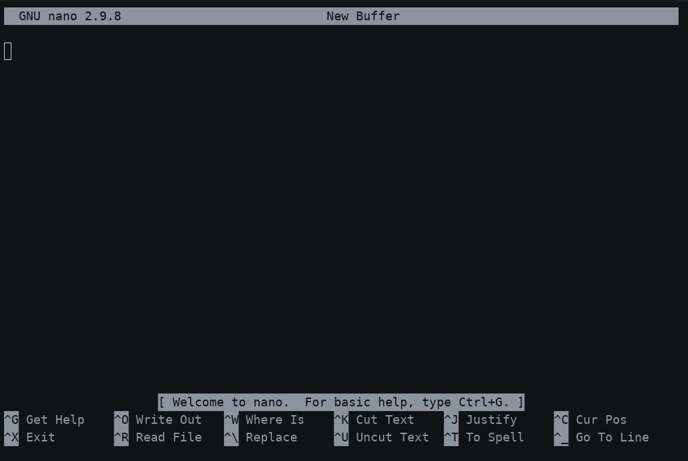
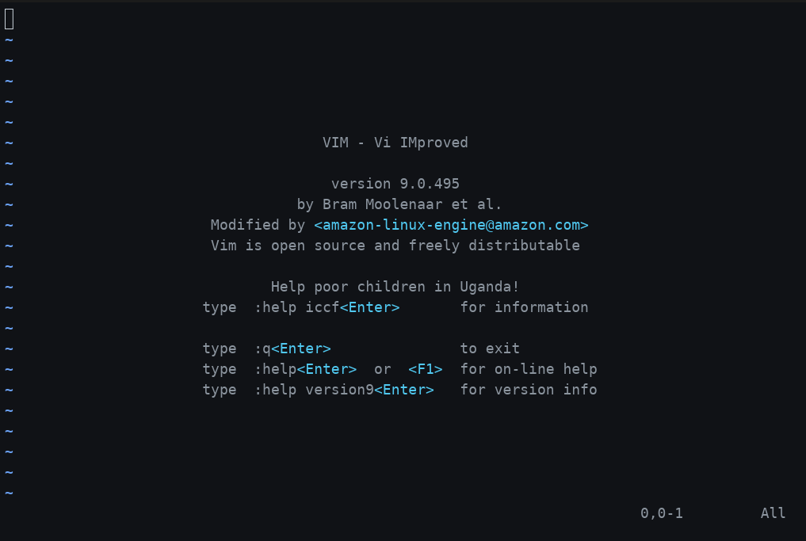

# <strong>Lab 10: App Admin</strong> {.unnumbered}

```{r}
#| label: common
#| include: false
source("_common.R")
```

```{r}
#| label: co_box_rev
#| echo: false
#| results: asis
#| eval: true
co_box(
  color = "o",
  look = "default", 
  hsize = "1.25", 
  size = "1.00", 
  header = "Caution", 
  fold = FALSE,
  contents = "This section is being revised. Thank you for your patience."
)
```

## Comprehension questions

> "*What are two different ways to install Linux applications, and what are the commands?*"

My instance is Amazon Linux 2, so the system package manager is `yum`, not Ubuntu's `apt`:

* `sudo yum install <package>` pulls a package (and its dependencies) from AL2's configured repositories.
  * `sudo yum update` keeps everything already installed current.
* For software that isn't in the repos, I download the package myself with `wget <url>` and install it directly: 

  ```{bash}
  #| eval: false
  #| code-fold: false
  sudo yum localinstall <package>.rpm
  # or
  sudo rpm -i <package>.rpm
  ```

  * No dependency resolution beyond what's already on the box, so this is my second choice, not my first.

> "*What does it mean to daemonize a Linux application? What programs and commands are used to do so?*"

Daemonizing an application means running it as a background service that starts on boot, restarts if it crashes, and keeps running independent of any login session, instead of a process that dies the moment I close my SSH connection.

On AL2, `systemd` is the program that manages this, and `systemctl` is how I talk to it:

```{mermaid}
%%| fig-cap: 'Daemonizing with systemd'
%%| fig-width: 7.0
%%| fig-align: 'center'
%%{init: {'theme': 'base', 'themeVariables': {'fontFamily': 'monospace', "fontSize":"12px"}}}%%

graph TD
    subgraph Unit["Unit File"]
        DotService["<strong>/etc/systemd/system/*.service</strong>"]
    end
    Reload["<strong>systemctl daemon-reload</strong>"]
    Enable["<strong>systemctl enable</strong>"]
    Start["<strong>systemctl start</strong>"]
    Status["<strong>systemctl status</strong>"]

    Unit --> Reload --> Enable --"<em>starts on boot</em>"--> Start --"<em>running now</em>"--> Status

    style DotService stroke:#fff,stroke-width:1px,color:#000,font-family:monospace,font-size:11px
    style Unit fill:#1B2A41,stroke:#fff,stroke-width:1px,color:#fff
    style Reload fill:#2A6F77,stroke:#fff,stroke-width:1px,color:#fff,font-family:monospace,font-size:14px
    style Enable fill:#2A6F77,stroke:#fff,stroke-width:1px,color:#fff,font-family:monospace
    style Start fill:#5B8C5A,stroke:#fff,stroke-width:1px,color:#fff,font-family:monospace
    style Status fill:#E8A33D,stroke:#000,stroke-width:1px,color:#000,font-family:monospace

```

Once the unit file exists, `systemctl restart` and `systemctl stop` manage it going forward, and `systemctl disable` stops it from starting on boot.

### A worked example: daemonizing a real app

`baseball-trajectory`, the app installed in [Install Apps](install-apps.qmd), is a good illustration of why daemonizing matters and what it actually looks like in a unit file. Started by hand from an SSH session, it dies the moment that session closes. Run as a service on an EC2 instance, `systemd` starts it on boot, restarts it after a crash, and collects its output, with something in front of it terminating TLS (covered in [Configure SSL](configure-ssl.qmd)).

```{mermaid}
%%| fig-cap: 'baseball-trajectory Deployment on EC2'
%%| fig-width: 8.0
%%| fig-align: 'center'
%%{init: {'theme': 'base', 'themeVariables': {'fontFamily': 'monospace', "fontSize":"12px"}}}%%

graph TD
    Op(["Operator<br/>browser"])
    Admin(["You<br/>SSH client"])

    subgraph EC2["EC2 Instance"]
        Nginx["<strong>nginx</strong><br/>:443 TLS"]
        App["<strong>baseball-trajectory</strong><br/>127.0.0.1:8000"]
        Sysd[("<strong>systemd</strong> + <strong>journald</strong>")]
    end
    MLB(["MLB Stats API<br/>statsapi.mlb.com"])

    Op --"HTTPS :443"--> Nginx
    Admin --"SSH :22"--> EC2
    Nginx --"HTTP :8000"--> App
    App --"<em>HTTPS :443</em>"--> MLB
    Sysd --"<em>supervises</em>"--> App

    style EC2 fill:#1B2A41,stroke:#fff,stroke-width:2px,color:#fff
    style Op fill:#d2562b,stroke:#fff,stroke-width:2px,color:#fff
    style Admin fill:#d2562b,stroke:#fff,stroke-width:2px,color:#fff
    style Nginx fill:#2a6f77,stroke:#fff,stroke-width:1px,color:#fff
    style App fill:#5b8c5a,stroke:#fff,stroke-width:2px,color:#fff
    style MLB fill:#666,stroke:#999,stroke-width:1px,color:#fff
    style Sysd fill:#e8a33d,stroke:#000,stroke-width:2px,color:#000
```

Notice the one outbound arrow. The app pulls rosters and career stats from the MLB Stats API on demand, so the instance's security group and any NAT path have to allow outbound HTTPS, or the app starts cleanly and then fails on the first player lookup.

Create the unit file:

```{bash}
#| eval: false
#| code-fold: false
sudo vim /etc/systemd/system/baseball-trajectory.service
```

And give it this content:

```{verbatim}
[Unit]
Description=baseball-trajectory
After=network.target

[Service]
Type=simple
User=baseball-trajectory
WorkingDirectory=/opt/baseball-trajectory
ExecStart=/opt/baseball-trajectory/.venv/bin/shiny run baseball_trajectory.app:app --host 127.0.0.1 --port 8000
Restart=on-failure
RestartSec=5

[Install]
WantedBy=multi-user.target
```

Four lines in there are doing the work worth understanding.

`User=baseball-trajectory` runs the process as the service account from [Linux Users](linux-users.qmd), not `root`. The app only serves requests and calls an external API, so that account needs no extra privilege at all.

`ExecStart` uses the absolute path into the venv. There's no shell involved, no `PATH` to search, and no activation step. If this path is wrong the unit fails instantly, and it's the single most common cause of a failed first start.

`--host 127.0.0.1` binds the app to loopback only. Change it to `0.0.0.0` and the app is reachable from the internet without TLS and without the proxy, which is exactly what we don't want.

`Restart=on-failure` with `RestartSec=5` brings the app back after a crash, waiting five seconds between attempts so a fast crash loop doesn't spin the CPU.

Load the new file and start the service:

```{bash}
#| eval: false
#| code-fold: false
sudo systemctl daemon-reload
sudo systemctl enable --now baseball-trajectory
```

`daemon-reload` tells `systemd` to reread the unit files on disk. `enable` registers the unit to start on boot, and `--now` starts it immediately so you don't have to run `start` separately.

#### Confirming it actually came up

Never trust `enable --now` to mean the app is running. It means `systemd` tried.

```{bash}
#| eval: false
#| code-fold: false
sudo systemctl status baseball-trajectory
```

```{verbatim}
● baseball-trajectory.service - baseball-trajectory
   Loaded: loaded (/etc/systemd/system/baseball-trajectory.service; enabled; vendor preset: disabled)
   Active: active (running) since Sat 2026-09-05 18:22:41 UTC; 12s ago
 Main PID: 4812 (python3.12)
   CGroup: /system.slice/baseball-trajectory.service
           └─4812 /opt/baseball-trajectory/.venv/bin/python3.12 /opt/baseball-trajectory/.venv/bin/shiny run baseball_trajectory.app:app --host 127.0.0.1 --port 8000

Sep 05 18:22:41 ip-172-31-24-9 systemd[1]: Started baseball-trajectory.
Sep 05 18:22:42 ip-172-31-24-9 shiny[4812]: INFO:     Started server process [4812]
Sep 05 18:22:42 ip-172-31-24-9 shiny[4812]: INFO:     Uvicorn running on http://127.0.0.1:8000
```

Two things to read here. `Active: active (running)` is the state, and `enabled` in the `Loaded:` line is the confirmation it will come back after a reboot. A unit can be running and not enabled, which works fine until the instance restarts.

Then confirm something is actually listening, from the instance itself:

```{bash}
#| eval: false
#| code-fold: false
curl -I http://127.0.0.1:8000
```

```{verbatim}
HTTP/1.1 200 OK
date: Sat, 05 Sep 2026 18:23:10 GMT
server: uvicorn
content-type: text/html; charset=utf-8
```

A `200` means the landing page rendered. A redirect is fine too. Connection refused means the process died between `status` and `curl`, and the journal will say why:

```{bash}
#| eval: false
#| code-fold: false
sudo journalctl -u baseball-trajectory -n 50 --no-pager
```

`-u` filters to this unit, `-n 50` limits it to the last 50 lines, and `--no-pager` dumps it straight to the terminal instead of opening `less`. When you want to watch a start attempt live, `journalctl -u baseball-trajectory -f` follows the log the same way `tail -f` does.

```{r}
#| label: co_box_startup_fail
#| echo: false
#| results: asis
#| eval: true
co_box(
  color = "y",
  look = "default",
  hsize = "1.15",
  size = "1.00",
  header = "Reading a failed start",
  fold = TRUE,
  contents = "
Four failures account for almost every bad first start, and each has a distinct signature in `journalctl -u baseball-trajectory`:

| What the journal says | What's actually wrong |
|:----------------------|:----------------------|
| `Failed at step EXEC ... No such file or directory` | The `ExecStart` path is wrong. Check it with `ls /opt/baseball-trajectory/.venv/bin/shiny` |
| `ModuleNotFoundError: No module named 'baseball_trajectory'` | `pip install -e .` ran somewhere other than `/opt/baseball-trajectory`, or into a different venv |
| `Address already in use` | Something already holds `:8000`, often a `shiny run` you started by hand and forgot |
| `status=203/EXEC` with no other output | The venv was built from a Python that no longer exists at that path |

The pattern in all four is the same: `systemd` executes a literal path with no shell, so anything the interactive session was quietly providing has to be spelled out in the unit file.
  "
)
```

> "*How do you know if you've opened Nano or Vim? How would you exit them if you didn’t mean to?*"

Nano tells me right away: the bottom of the screen fills with a menu of keybindings (`^X Exit`, `^O Write Out`, etc.), and I can just start typing. Vim gives no such hints: it opens in **normal mode**, the screen is otherwise blank (empty lines marked with `~`), and typing does nothing useful until I switch to **insert mode**. That silence is usually how I know I've landed in Vim by accident.

To back out without changing anything:

**Nano**: `Ctrl + X`, then answer `N` if it asks whether to save

{width='100%'}

**Vim**: press `Esc` first to make sure I'm in normal mode (not typing into the file), then type `:q!` and hit `Enter` to quit and discard any changes.

{width='100%'}

> *"What are four commands to read text files?"*

`cat`, `less`, `head`, and `tail`. I reach for `cat` on short files, `less` for anything long enough to scroll, `head` when I only need the first lines, and `tail -f` when I want to watch a log file update in real time.

> "*How would you create a file called secrets.txt, open it with Vim, write something in, close and save it, and make it so that only you can read it?*"

```{bash}
#| eval: false
#| code-fold: false
vim secrets.txt
```

From there:

1.  Press `i` to enter insert mode and type the content.
2.  Press `Esc` to return to normal mode.
3.  Type `:wq` and hit `Enter` to write (save) and quit.

Then lock it down so only I can read it:

```{bash}
#| eval: false
#| code-fold: false
chmod 600 secrets.txt
```

`600` gives the owner read/write and removes every permission for group and other; it's the same restriction I already use on `.ssh/authorized_keys` in [Linux Users](linux-users.qmd).

## Recap

1. On Amazon Linux 2, `sudo yum install` pulls a package and its dependencies from the configured repositories. A downloaded `.rpm` installed with `yum localinstall` or `rpm -i` is my second choice, because it can't lean on the repositories for dependencies.

2. Daemonizing hands the app to `systemd`: write a unit file in `/etc/systemd/system`, then run `systemctl daemon-reload` and `systemctl enable --now`. In the `baseball-trajectory` unit, `User=`, the absolute `ExecStart` path into the venv, `--host 127.0.0.1`, and `Restart=on-failure` do the real work.

3. `enable --now` only means `systemd` tried. I confirm with `systemctl status` (looking for `active (running)` and `enabled`), then `curl -I http://127.0.0.1:8000`, and I read `journalctl -u baseball-trajectory` when either one fails.

4. Nano shows its keybindings and exits with `Ctrl + X`; Vim opens silently in normal mode and exits without saving with `Esc`, then `:q!`. `chmod 600` makes a file like `secrets.txt` readable only by its owner.

[Install Apps](install-apps.qmd) covers `PATH`, installing language runtimes into `/opt`, and installing `baseball-trajectory` itself.
