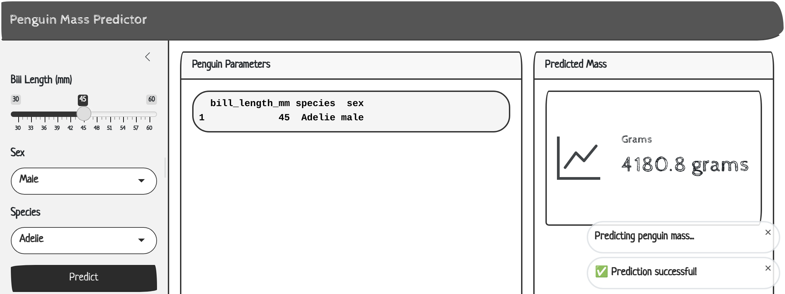

# <em>R App & API</em> {.unnumbered}

```{r}
#| label: common
#| include: false
source("_common.R")
```

```{r}
#| label: co_box_rev
#| echo: false
#| results: asis
#| eval: false
co_box(
  color = "o",
  look = "default", 
  hsize = "1.25", 
  size = "1.00", 
  header = "Caution", 
  fold = FALSE,
  contents = "This section is being revised. Thank you for your patience."
)
```

This chapter builds the R version of [Python App & API](py-app-api.qmd). I'll launch a `vetiver` API in one session and send predictions to it from a Shiny app (using `httr2`) in another.

I isolated development for the R Shiny app and API for lab 3 into separate `app/` and `api/` directories:

```{r}
#| eval: false 
#| echo: false
fs::dir_tree("_labs/lab03/R", recurse = 1)
```

::: {style="font-style: italic;"}

```{verbatim}
_labs/lab03/R
├── api #<1>
│   ├── api.Rproj
│   ├── mod-api.R 
│   ├── model.R
│   ├── models/
│   ├── my-db.duckdb
│   ├── README.md
│   ├── renv
│   └── renv.lock #<1>
├── app #<2>
│   ├── app-api.R
│   ├── app.Rproj
│   ├── README.md
│   ├── renv
│   └── renv.lock #<2>
├── eda-db.qmd #<3>
├── r-data-load.R #<4>
└── R.Rproj

```
1.  `vetiver` model API\
2.  `shiny` application\
3.  EDA of `palmerpenguins` data using `dplyr` and `ggplot2`\
4.  Load `palmerpenguins` data into `duckdb`

:::

## Model

The API reads the model from a `pins` board in `models/`, and that board doesn't exist until we train and pin the model. Open a RStudio/Positron session from [`_labs/lab03/R/api/`](https://github.com/mjfrigaard/do4ds-labs/tree/main/_labs/lab03/R/api) and run [`model.R`](https://github.com/mjfrigaard/do4ds-labs/blob/main/_labs/lab03/R/api/model.R):

```{r}
#| eval: false
#| code-fold: false
source("model.R")
```

This is the same linear model from [R processing layer](model-vetiver-r.qmd), with three changes: 

1. The query drops rows with missing values and keeps `bill_length_mm` between 30 and 60, so 333 of the 344 rows remain.  
2. `lm()` takes `species` and `sex` as factors and creates the dummy variables itself (lab 2 built them with `dummy_cols()`).  
3. As a result, the `vetiver` prototype has three columns, and the API expects `species` and `sex` as strings.

::: {style="font-style: italic;"}

```{verbatim}
Loaded 333 observations from DuckDB

=== Model Training Complete ===
Formula:
body_mass_g ~ bill_length_mm + species + sex

Coefficients:
     (Intercept)   bill_length_mm speciesChinstrap    speciesGentoo 
      2169.26972         32.53689       -298.76553       1094.86739 
         sexmale 
       547.36692 
===============================

Vetiver prototype (API will expect this format):
# A tibble: 0 × 3
# ℹ 3 variables: bill_length_mm <dbl>, species <fct>, sex <fct>

Creating new version '20261127T072151Z-d2aea'
Writing to pin 'penguin_model'
✓ Model trained and pinned successfully
  Model name: penguin_model 
  Pin location: ./models/penguin_model
```

:::

The coefficients match lab 2. We can confirm the board exists by listing the `models/` folder:

```{r}
#| eval: false
#| code-fold: false
fs::dir_tree("models")
```

::: {style="font-style: italic;"}

```{verbatim}
models
└── penguin_model
    └── 20261127T072151Z-d2aea
        ├── data.txt
        └── penguin_model.rds
```

:::

## API

In a RStudio/Positron session opened from [`_labs/lab03/R/api/`](https://github.com/mjfrigaard/do4ds-labs/tree/main/_labs/lab03/R/api), the [`mod-api.R` file](https://github.com/mjfrigaard/do4ds-labs/blob/main/_labs/lab03/R/api/mod-api.R) contains the following (I've removed the sections that print the model info):

```{r}
#| eval: false
# pkgs
library(vetiver)
library(pins)

# connect to lab03 model board ----
model_board <- pins::board_folder("models/")

# read pinned vetiver model ----
v <- vetiver::vetiver_pin_read(model_board, "penguin_model")

# create plumber API ----
app <- plumber::pr() |> vetiver::vetiver_api(v) 
```

### Start the API

Run the API below in its own session; `pr_run()` blocks the console, so we'll launch the app from a second session.

```{r}
#| eval: false
app |> plumber::pr_run(port = 8080, host = "127.0.0.1")
```

{fig-align="center" width="100%"}

Now we have a working API! We'll explore the UI in the sections below. Let's launch the app.[^plumber]

[^plumber]: I've also created an updated [`plumber`](plumber.qmd) API in the `plumber.R` file. 

## App

Open a separate RStudio/Positron session from [`_labs/lab03/R/app/`](https://github.com/mjfrigaard/do4ds-labs/tree/main/_labs/lab03/R/app) and launch the app with `app-api.R`. I've made a few changes to the UI layout, so when I launch the app, I see the following:

{fig-align="center" width="100%"}

View the UI changes below:

```{r}
#| eval: false 
#| code-fold: true 
#| code-summary: 'show/hide UI changes to app-api.R'

api_url <- "http://127.0.0.1:8080/predict"

ui <- page_sidebar(
  title = "Penguin Mass Predictor",
  theme = bs_theme(bootswatch = "sketchy"),
  sidebar = sidebar(
    sliderInput(inputId = "bill_length", 
      label = "Bill Length (mm)",
      min = 30, 
      max = 60, 
      value = 45, 
      step = 1),
    selectInput(inputId = "sex", 
      label = "Sex", 
      choices = c("Male", "Female"), 
      selected = "Male"),
    selectInput(
      inputId = "species",
      label = "Species",
      choices = c("Adelie", "Chinstrap", "Gentoo"),
      selected = "Adelie"),
    actionButton(
      inputId = "predict", 
      label = "Predict", 
      class = "btn-primary")
  ),
  
  layout_columns(
    card(
      card_header("Penguin Parameters"),
      card_body(
      verbatimTextOutput("vals")
      )
    ),
    card(
      card_header("Predicted Mass"),
      card_body(
        value_box(
          showcase_layout = "left center",
          title = "Grams",
          value = textOutput("pred"),
          showcase = bs_icon("graph-up"),
          max_height = "200px",
          min_height = "200px",
        )
      )
    ),
    col_widths = c(7, 5)
  )
)
```

### Original error

In the original server, `vals()` returned a `list()` (the full code is in [Original App Code](#original-app-code) at the end of this chapter). With that list, clicking **Predict** produced the following error:

::: {style="font-style: italic;"}

```{verbatim}
Warning: Error in httr2::req_perform: 
HTTP 500 Internal Server Error.
```

:::

In the API session, we also see an error:

::: {style="font-style: italic;"}

```{verbatim}
<error/rlang_error>
Error in `hardhat::validate_column_names()`:
! `data` must be a data frame or a matrix, not a list.
```

:::

Both errors point to the same problem. `httr2::req_body_json()` sends the list as a single JSON object, but the `vetiver` API expects a data frame or a matrix.

We can fix this in the application server by changing the format of the values sent to the API.

### Reactive values

The API error tells us `data` must be a data frame or a matrix. We'll convert `vals()` to a single row `data.frame` with the columns the model was trained on: `bill_length_mm`, `species`, and `sex` (lowercase, to match the factor levels in the data).

```{r}
#| eval: false
  vals <- reactive({
    data.frame(
      bill_length_mm = input$bill_length,
      species = input$species,
      sex = tolower(input$sex)
    )
  })
```

### Predictions

The `pred()` reactive sends `vals()` to the API and returns only `response$.pred[[1]]`.

```{r}
#| eval: false
#| code-fold: false
 pred <- reactive({
    tryCatch({
    showNotification("Predicting penguin mass...", 
                     type = "default", duration = 10)
        
    request_data <- vals()
    response <- httr2::request(api_url) |> #<1>
      httr2::req_method("POST") |>
      httr2::req_body_json(request_data, auto_unbox = FALSE) |>  #<2>
      httr2::req_perform() |>
      httr2::resp_body_json()
        
    showNotification("✅ Prediction successful!", 
                     type = "default", duration = 10)
        
    response$.pred[[1]]
        
    }, error = function(e) {
      error_msg <- conditionMessage(e)
      
      if (grepl("Connection refused|couldn't connect", error_msg, ignore.case = TRUE)) {
        user_msg <- "API not available - is the server running on port 8080?"
      } else if (grepl("timeout|timed out", error_msg, ignore.case = TRUE)) {
        user_msg <- "Request timed out - API may be overloaded"
      } else {
        user_msg <- paste("API Error:", substr(error_msg, 1, 50))
      }
      
      showNotification(paste("❌", user_msg), type = "warn", duration = 10)
      
      paste("❌", user_msg)
      })
    }) |> 
    bindEvent(input$predict, ignoreInit = TRUE)
```
1. `api_url` is "http://127.0.0.1:8080/predict"   
2. `request_data` is a single row data frame, so `req_body_json()` sends it as a JSON array with one object per row (the format `vetiver` expects). `auto_unbox = FALSE` doesn't change the JSON for a data frame.   


### R API Request/Response Flow

The sections below cover the `httr2` functions used in the Shiny API app. The diagram shows how each function hands its result to the next:

```{mermaid}
%%| fig-cap: 'The httr2 Request Pipeline'
%%| fig-align: 'center'
%%{init: {'theme': 'base', 'look': 'classic', 'themeVariables': {'fontFamily': 'monospace'}}}%%

flowchart TD
    A(["<strong>request()</strong><br>sets the URL"]) --> B("<strong>req_method()</strong><br>sets the verb (POST)")
    B --> C("<strong>req_body_json()</strong><br>adds vals() as JSON")
    C --> D("<strong>req_perform()</strong><br>sends the request")
    D --> E["vetiver API<br>/predict"]
    E --> F[/"JSON response"/]
    F --> G("<strong>resp_body_json()</strong><br>parses JSON into an R list")
    style A fill:#5B8C5A,stroke:#000000,stroke-width:1px,color:#ffffff
    style B fill:#D2562B,stroke:#000000,stroke-width:1px,color:#ffffff
    style C fill:#D2562B,stroke:#000000,stroke-width:1px,color:#ffffff
    style D fill:#2A6F77,stroke:#000000,stroke-width:1px,color:#ffffff
    style E fill:#485466,stroke:#000000,stroke-width:1px,color:#ffffff
    style F fill:#D2562B,stroke:#000000,stroke-width:1px,color:#ffffff
    style G fill:#2A6F77,stroke:#000000,stroke-width:1px,color:#ffffff
```

#### The `request()`

`httr2::request()` creates the initial request object that all other functions will modify:

*   Stores the base URL

*   Uses `GET` by default (and `POST` once a body is added)

*   Initializes empty headers, query parameters, and body

*   Returns a modifiable request object

```{r}
#| eval: false
#| code-fold: false
# creates a base request with URL
response <- httr2::request(api_url)
```

#### `req_method()` 

*verb specification*

`httr2::req_method()` specifies which HTTP method to use for the request.

*   **`GET`**: Retrieve data (no body allowed)

*   **`POST`**: Send new data (body allowed)

*   **`PUT`**: Update existing data (body allowed)

*   **`DELETE`**: Remove data (usually no body)

```{r}
#| eval: false
#| code-fold: false
response <- httr2::request(api_url) |>
  httr2::req_method("POST") # sending data
```

#### `req_body_json()`

*request body*

`httr2::req_body_json()` converts R objects to JSON and includes them in the request body.

*   Converts R `list`s/`data.frame`s to JSON format

*   Sets `Content-Type: application/json` header automatically

*   Includes the JSON in the HTTP request body

*   Used primarily with `POST`/`PUT` requests

```{r}
#| eval: false
#| code-fold: false
vals <- reactive({
  data.frame(
    bill_length_mm = input$bill_length,
    species = input$species,
    sex = tolower(input$sex)
  )
})

request_data <- vals()

response <- httr2::request(api_url) |>
  httr2::req_method("POST") |> # sending data
  httr2::req_body_json(request_data, auto_unbox = FALSE)
```

#### `req_perform()`

*execute request*

`httr2::req_perform()` actually sends the HTTP request to the server and returns a response:

What happens:\
1. Combines all request components (method, headers, query, body)\
2. Opens network connection to server\
3. Sends HTTP request\
4. Waits for server response\
5. Returns response object for processing

```{r}
#| eval: false
#| code-fold: false
response <- httr2::request(api_url) |>
  httr2::req_method("POST") |> # sending data
  httr2::req_body_json(request_data, auto_unbox = FALSE) |> 
  httr2::req_perform()
```


#### `resp_body_json()`

*JSON response parsing*

`httr2::resp_body_json()` parses JSON response body into R objects.

* Converts JSON arrays to R vectors/lists

* Converts JSON objects to R named lists

* Handles nested JSON structures

* Automatically converts data types (numbers, booleans, strings)

```{r}
#| eval: false
#| code-fold: false
response <- httr2::request(api_url) |>
  httr2::req_method("POST") |> # sending data
  httr2::req_body_json(request_data, auto_unbox = FALSE) |> 
  httr2::req_perform() |> 
  httr2::resp_body_json()
```

## Verify

Now when we launch the app, the preview of the parameters is in a `data.frame` (not a list):

{fig-align="center" width="100%"}

When we click **Predict**, we see notifications and the value is returned:

{fig-align="center" width="100%"}

### Back in the API

If we return to the `plumber` UI, we can click on **Return predictions from model using 3 features**. We change the JSON values to match our parameters in the app, then click **TRY**:

{fig-align="center" width="100%"}

And we can compare the response to the value we saw in the app:

{fig-align="center" width="100%"}

The diagram below follows one prediction from the Shiny app through the `plumber` API to the `vetiver` model:

```{mermaid}
%%| fig-cap: 'Input Dependencies'
%%| fig-align: 'center'
%%{init: {'theme': 'base', 'look': 'classic', 'themeVariables': {'fontFamily': 'monospace'}}}%%

sequenceDiagram
    participant Customer as Shiny<br>App
    participant Waiter as Plumber<br>API
    participant Kitchen as Vetiver<br>Model
    
    Customer->>Waiter: Prediction request:<br>bill_length=45,<br>species=Adelie, sex=male
    Waiter->>Kitchen: Prepare data
    Kitchen->>Waiter: Perform prediction
    Waiter->>Customer: Returns prediction:<br>4180.8 grams

```

## Finishing touches

To keep the R environment in each directory self-contained and reproducible, we should initialize an `renv` project in each folder.

```{r}
#| eval: false 
renv::init()
```

This results in the following files:

### `R/api/` files

::: {style="font-style: italic;"}

```{verbatim}
_labs/lab03/R/api
├── README.md
├── api.Rproj
├── mod-api.R
├── model.R
├── models
│   └── penguin_model
├── my-db.duckdb
├── renv
│   ├── activate.R
│   ├── library
│   ├── settings.json
│   └── staging
└── renv.lock
```

:::

### `R/app/` files

::: {style="font-style: italic;"}

```{verbatim}
_labs/lab03/R/app
├── README.md
├── app-api.R
├── app.Rproj
├── renv
│   ├── activate.R
│   ├── library
│   ├── settings.json
│   └── staging
└── renv.lock
```

:::

## Recap

1. The `vetiver` API only takes a few lines in R: read the pinned model with `vetiver_pin_read()`, pass it to `vetiver_api()` on a `plumber` router, and start it with `pr_run()` on port 8080.

2. The original app failed with an `HTTP 500` error because it sent the inputs as a JSON list, and the `vetiver` API expects a data frame or matrix. Building `vals()` as a single row `data.frame` (with `species` and `sex` as strings) fixed the request.

3. The `httr2` request is a pipeline: `request()` sets the URL, `req_method()` sets the verb, `req_body_json()` attaches the data, `req_perform()` sends it, and `resp_body_json()` parses the response. Wrapping that pipeline in `tryCatch()` turns connection failures and timeouts into notifications instead of a crashed app.

In [`plumber`](plumber.qmd) we'll rebuild this API with custom handler functions, input validation, and batch predictions.

## Original App Code

To view the original code in `app-api.R`, expand the section below:

<details>

<summary>Expand to view the original app-api.R</summary>

```{r}
#| label: print-app-api-R
#| echo: false
library(readr)
readr::read_lines("_labs/lab03/app-api.R") |> 
  base::noquote() |> 
  writeLines()
```

</details>

